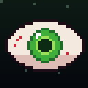

# Health Guard — Nhắc bảo vệ mắt cho VS Code

[English](README.md) | **Tiếng Việt**

[](https://marketplace.visualstudio.com)
[](https://github.com/mquand/health-guard/releases)
[]()
[](LICENSE)

> Extension VS Code nhỏ gọn, thân thiện quyền riêng tư — nhắc bạn theo quy tắc **20-20-20**, **uống nước** và **đứng dậy vận động**, với bảng nhắc tối giản theo theme hoặc cảnh pixel art động.

<p align="center">
  
</p>

---

## 💡 Vấn đề giải quyết

Khi code hàng giờ liên tục:
- Mắt dán vào màn hình quá lâu gây mỏi, khô và mỏi mệt.
- Quên uống nước đến khi cơ thể đã thiếu nước.
- Ngồi nhiều giờ không vận động — không tốt cho lưng, tư thế và tuần hoàn.

**Health Guard** nằm im lìm trên thanh trạng thái và nhắc bạn bằng những lời nhắc thân thiện, tuỳ chỉnh được — không tài khoản, không telemetry, không dữ liệu nào rời khỏi máy.

---

## ✨ Tính năng chính

### 1. Nghỉ mắt 20-20-20
- Cứ mỗi 20 phút (tuỳ chỉnh), nhắc nhìn ra xa khoảng 6 m (20 feet) trong 20 giây.
- **Đếm ngược từng giây** kèm thanh tiến trình để biết chính xác khi nào hết giờ.

### 2. Nhắc uống nước & vận động
- **Uống nước** — nhắc định kỳ (mặc định 45 phút).
- **Đứng dậy đi bộ** — nhắc vươn vai, đi lại hoặc đi vệ sinh (mặc định 90 phút).
- Mỗi loại nhắc bật/tắt và đặt lịch riêng.

### 3. Hai giao diện: Tối giản hoặc Pixel art
- **`clean` (mặc định)** — thẻ nhỏ theo theme VS Code (sáng/tối đều hợp), icon SVG nét mảnh, số đếm ngược lớn.
- **`pixel`** — cảnh pixel art 160×120 động nhờ [pixelfx](https://github.com/patch-gg/pixelfx) (MIT), nền gradient + sao + bụi sáng trôi nổi.

### 4. Chín hiệu ứng pixel art
Chọn hiệu ứng riêng cho từng loại nhắc, hoặc xem thử tất cả bằng một lệnh:

| Nhắc | Hiệu ứng |
| :--- | :--- |
| Nghỉ mắt | `eyeball` · `halo` · `heal` |
| Uống nước | `water-orb` · `fountain` · `potion` |
| Đi bộ | `bird` · `frog` · `butterfly` |

### 5. Lên lịch thông minh, không làm phiền
- **Theo focus**: hoãn nhắc khi cửa sổ VS Code không được chọn (`healthGuard.onlyWhenFocused`).
- **Tạm dừng toàn bộ** 30 phút hoặc đến khi bật lại — lưu qua các lần khởi động lại.
- **Hoãn (snooze)** mỗi lời nhắc theo số phút tuỳ chỉnh.
- Kiểu hiển thị **bảng panel** hoặc **thông báo nhỏ** cho nhắc nước/đi bộ (`healthGuard.popupStyle`).
- Chuông nhẹ tổng hợp bằng WebAudio (không cần file âm thanh), tắt được.

### 6. Thanh trạng thái + menu nhanh
- Nhìn thoáng thời gian còn lại đến lời nhắc kế tiếp ngay trên status bar, tooltip liệt kê toàn bộ lịch.
- Menu 1-click: kích hoạt nhắc ngay, tạm dừng/tiếp tục, mở Settings, xem thử hiệu ứng, bật/tắt extension.

### 7. Tự cập nhật qua GitHub Releases
- Kiểm tra [GitHub Releases](https://github.com/mquand/health-guard/releases) tối đa một lần mỗi 24 giờ.
- **Cập nhật ngay** tải file `.vsix` mới nhất và cài trực tiếp, sau đó hỏi reload 1-click.
- Kiểm tra thủ công bất cứ lúc nào qua `Health Guard: Kiểm tra cập nhật` — tắt auto-check bằng `healthGuard.checkUpdates`.

---

## ⚙️ Cài đặt (Settings)

Mở `Settings` (`Cmd + ,` / `Ctrl + ,`) rồi tìm `healthGuard`:

| Khoá | Mặc định | Ý nghĩa |
| :--- | :--- | :--- |
| `healthGuard.enabled` | `true` | Bật/tắt toàn bộ extension |
| `healthGuard.startPaused` | `false` | Mỗi lần mở VS Code thì bắt đầu ở trạng thái tạm dừng |
| `healthGuard.onlyWhenFocused` | `true` | Chỉ nhắc khi cửa sổ VS Code đang được chọn |
| `healthGuard.sound` | `true` | Chuông nhẹ khi mở/hoàn tất (WebAudio) |
| `healthGuard.focusOnReminder` | `true` | Tự chuyển focus sang bảng nhắc nhở |
| `healthGuard.appearance` | `clean` | `clean` (tối giản, theo theme) hoặc `pixel` (cảnh pixelfx) |
| `healthGuard.popupStyle` | `panel` | `panel` hoặc `notification` cho nhắc nước/đi bộ |
| `healthGuard.snoozeMinutes` | `5` | Số phút khi bấm "Nhắc lại sau …" |
| `healthGuard.checkUpdates` | `true` | Tự kiểm tra GitHub Releases (tối đa 1 lần/24 giờ) |
| `healthGuard.eyeBreak.enabled` | `true` | Bật nhắc 20-20-20 |
| `healthGuard.eyeBreak.intervalMinutes` | `20` | Số phút giữa hai lần nghỉ mắt |
| `healthGuard.eyeBreak.durationSeconds` | `20` | Số giây đếm ngược mỗi lần nghỉ |
| `healthGuard.eyeBreak.effect` | `eyeball` | `eyeball` / `halo` / `heal` (chỉ khi appearance = `pixel`) |
| `healthGuard.eyeBreak.message` | … | Lời nhắc hiển thị |
| `healthGuard.water.enabled` | `true` | Bật nhắc uống nước |
| `healthGuard.water.intervalMinutes` | `45` | Số phút giữa hai lần nhắc |
| `healthGuard.water.effect` | `water-orb` | `fountain` / `potion` / `water-orb` (chỉ khi appearance = `pixel`) |
| `healthGuard.water.message` | … | Lời nhắc uống nước |
| `healthGuard.walk.enabled` | `true` | Bật nhắc đi bộ |
| `healthGuard.walk.intervalMinutes` | `90` | Số phút giữa hai lần nhắc |
| `healthGuard.walk.effect` | `bird` | `frog` / `bird` / `butterfly` (chỉ khi appearance = `pixel`) |
| `healthGuard.walk.message` | … | Lời nhắc đi bộ |

Mọi thay đổi có hiệu lực ngay, không cần khởi động lại VS Code.

---

## 🛠️ Cài đặt

### Cách 1: Cài từ file `.vsix` (khuyên dùng)
1. Tải `.vsix` mới nhất từ [GitHub Releases](https://github.com/mquand/health-guard/releases) — hoặc bấm **Cập nhật ngay** khi Health Guard thông báo.
2. Trong VS Code, nhấn `Cmd + Shift + P` / `Ctrl + Shift + P`.
3. Chạy `Extensions: Install from VSIX...` rồi chọn file.
4. Reload cửa sổ nếu được hỏi.

### Cách 2: Cài qua CLI
```bash
code --install-extension health-guard-1.1.1.vsix
```

### Cách 3: Chạy từ mã nguồn
```bash
git clone https://github.com/mquand/health-guard.git
cd health-guard/health-guard
npm install
npm run build
```
Mở thư mục `health-guard` trong VS Code rồi bấm `F5` để mở Extension Development Host.

---

## 💻 Lệnh (Command Palette — `Cmd/Ctrl + Shift + P`)

Tìm "Health Guard":

- `Health Guard: Menu`
- `Health Guard: Bắt đầu nghỉ mắt 20-20-20`
- `Health Guard: Nhắc uống nước ngay`
- `Health Guard: Nhắc đi bộ / đi vệ sinh`
- `Health Guard: Tạm dừng nhắc nhở` / `Tiếp tục nhắc nhở`
- `Health Guard: Bật / tắt Health Guard`
- `Health Guard: Mở cài đặt`
- `Health Guard: Xem thử hiệu ứng`
- `Health Guard: Kiểm tra cập nhật`

---

## 🧠 Cách hoạt động

```
src/extension.ts          vòng đời, lệnh, thanh trạng thái, điều phối
src/updater.ts            kiểm tra GitHub Releases + cài .vsix tại chỗ
src/scheduler.ts          bộ hẹn giờ 1 giây: tạm dừng, hoãn, chỉ bắn khi focus
src/panel.ts              webview panel, HTML + CSP, handshake ready → init
src/webview/main.js       DOM, đếm ngược, nút bấm, chuông WebAudio
src/webview/renderer.js   cảnh pixel 160×120 (chỉ tải khi appearance = pixel)
vendor/pixelfx/           bản rút gọn của pixelfx (core + 9 hiệu ứng), MIT
```

- Bộ đếm giờ chạy trên `setInterval`, không phụ thuộc animation, nên lần nghỉ vẫn kết thúc đúng giờ kể cả khi tab bị ẩn.
- Nếu cửa sổ mất focus và `onlyWhenFocused` bật, lời nhắc đến hạn được dời 30 giây thay vì bỏ hay bắn dồn.
- Trạng thái tạm dừng được lưu qua `globalState`, giữ nguyên sau khi khởi động lại VS Code.
- Không có dữ liệu nào rời khỏi máy. Không tài khoản, không telemetry.

## 💻 Phát triển

```bash
npm install
npm run build      # dist/extension.js + media/webview.js
npm run watch      # build lại khi sửa
npm run typecheck  # tsc --noEmit
npm test           # test scheduler + extension host + pixel smoke
npm run smoke      # render thử mọi hiệu ứng trong Node (không cần VS Code)
npm run preview    # xuất ảnh PNG vào preview/ để xem hiệu ứng
npm run package    # đóng gói health-guard-<version>.vsix
```

Push lên `main` (hoặc tag `v*`) sẽ kích hoạt `.github/workflows/release.yml` — tự build vsix và đăng GitHub Release.

## 📄 Giấy phép & ghi công

- Mã extension: [MIT](LICENSE).
- Hiệu ứng pixel art: [patch-gg/pixelfx](https://github.com/patch-gg/pixelfx), MIT — bản sao rút gọn nằm trong `vendor/pixelfx` kèm `LICENSE` và `NOTICE.md` gốc. Một số hiệu ứng của pixelfx được chuyển thể từ các tác phẩm MIT của Hugo Duprez và Hollow Crown — xem `vendor/pixelfx/NOTICE.md`.
